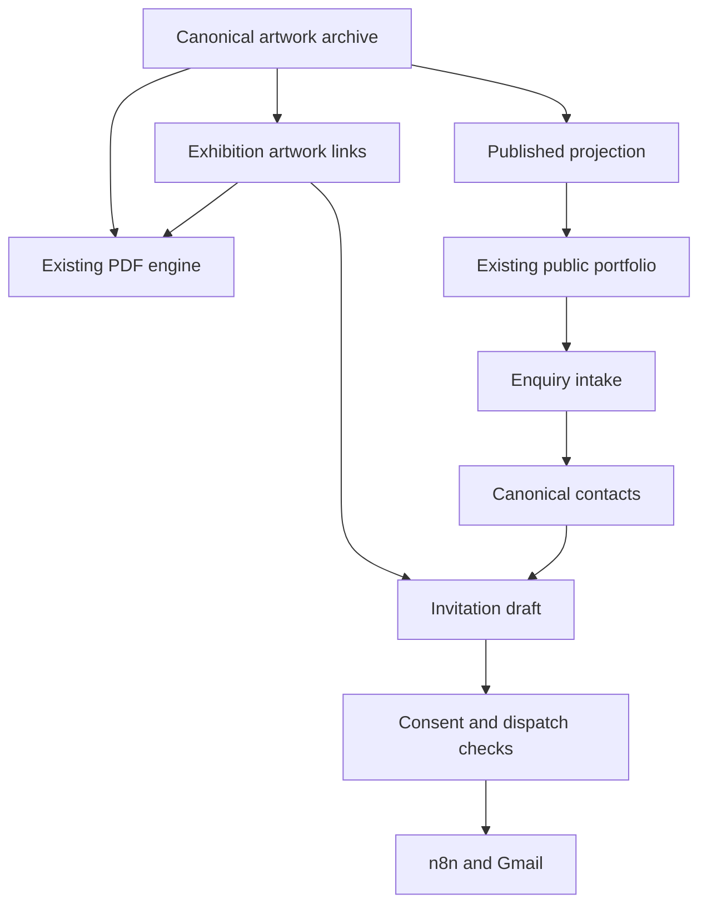

# Layered architecture

## Layer 1 — Experiences

Keep the existing public portfolio and authenticated studio as two layouts in one app. Visitors browse published artworks and send enquiries; only Ilse manages records. Private viewing links form a separate, limited-access surface. No public checkout and no staff management.

## Layer 2 — Route and layout ownership

Reuse `src/app/studio/layout.tsx`, `src/components/studio/studio-shell.tsx`, `sections.ts`, PageHeader, MetricCard and EmptyState. Keep `/studio` canonical and existing `/dashboard/*` redirects. Avoid remounting the email editor on tab changes or losing unsaved forms during shell changes.

| Sidebar group | Label | Existing canonical route | Secondary destinations |
|---|---|---|---|
| Main | Overview | `/studio` | Contextual quick actions |
| Main | Artwork Archive | `/studio/archive` | New, detail/edit, complete catalogue |
| Main | Portfolio Website | `/studio/website` | Publishing, artist profile, public preview |
| Main | Collectors | `/studio/collectors` | Profiles, enquiries, sales, invoices |
| Main | Email Studio | `/studio/email` | Editor, recipients, preview, send/history, automations |
| Main | Exhibitions | `/studio/exhibitions` | New/edit/detail, viewing rooms |
| Tools | Documents & PDFs | `/studio/tools` | Catalogues, maker, compressor, image optimizer |
| Tools | Reports | `/studio/reports` (proposed) | Real artwork/enquiry/campaign/sales data |
| General | Settings | `/studio/settings` (proposed) | Profile link, connection status, preferences |

Logout stays an authenticated action in the profile menu. Enquiries remain at `/studio/enquiries`; do not hide them beyond one secondary navigation click. Keep `/studio/sales`, `/studio/invoices`, `/studio/viewing-rooms` usable by direct link. Public `/unsubscribe` is proposed only if absent. Reuse `[id]` handling `new` for exhibitions instead of introducing a conflicting static editor.

## Layer 3 — Presentation components

Reuse existing primitives. Extend only where needed: StudioShell, SectionNav, PageHeader, MetricStrip, DataTable wrapper, ArtworkPicker, ContactPicker, status pill, filter bar, empty/error/setup state and guarded confirmation dialog. New wrappers must not duplicate data access or business rules. Large email/PDF/3D dependencies load only in their relevant modules.

## Layer 4 — Use cases

Existing handlers are the service layer; new folder names are unnecessary.

| Domain | Current implementation anchor | Owns |
|---|---|---|
| Archive | `src/app/actions/db.ts` | Artwork edits, media references, existing inventory workflow |
| Public projection | `src/lib/website/public-artwork-service.ts`, mappers | Safe published fields and artwork lookup |
| Collectors | `src/app/studio/collectors/actions.ts` | Contacts, notes, consent-aware import/selection |
| Enquiries | `src/lib/website/enquiries.ts` and studio inbox | Validated intake, artwork relationships, status |
| Exhibitions | `src/app/studio/exhibitions/actions.ts` | Metadata, ordered artwork links, publication |
| Email | `src/lib/email/dispatch.ts`, automations, send API | Protected dispatch; extend durable preparation and status |
| Documents | `src/lib/pdf-templates.tsx`, catalog and invoice helpers | Existing generation and export |
| Viewing rooms | `src/lib/viewing-rooms/*` | Token/expiry/revocation/access enforcement |
| Reports | Existing overview queries and `/api/events` | Aggregate facts with honest labels |

Read server data in existing server components where practical; use client components for interaction. Revalidate only affected routes/data after confirmed writes. Return field errors, retryable failures and stable IDs; never return success if a required write failed. Do not put secrets or privileged database calls in client bundles.

## Layer 5 — Canonical data

Existing `artworks` and `artwork_images` serve archive, website, email, PDFs, exhibitions and rooms. Existing `contacts` serves collectors, enquiries and recipient selection. Existing exhibition joins reference artwork IDs. Existing invoice snapshots intentionally retain historical amounts and names; this is valid historical evidence, not a second inventory.

Persistent campaign drafts/recipient jobs may need an additive schema after audit. Model them separately from the existing `email_campaign_log`, which currently represents dispatch attempts, not a queue. See 03-CONTRACTS. Do not rename existing tables or create `collectors` beside `contacts`.

## Layer 6 — Integrations

Preserve Supabase Auth, Postgres, existing storage buckets and n8n/Gmail. Verify bucket names/policies from code and the actual environment. Preserve current n8n payload and test/live modes. Server-side adapters may add internal metadata without silently changing downstream contracts. Provider configuration is external; a configured URL alone does not prove a workflow works.

## Layer 7 — Security and operations

Owner session guard on pages and every mutation/API; RLS and storage policies independently enforced. Public services expose allow-listed fields only. Private documents, contacts and room assets require scoped access. Non-production dispatch is disabled by default. Existing production schema/workflows remain untouched during local implementation. Keep a reversible feature toggle for the new studio styling if integration risk warrants it.

## Key workflows

Selecting artworks for an exhibition never makes them public automatically. Generating an invitation creates a draft; sending remains an explicit user action. A failed notification does not erase a stored enquiry. A failed PDF export does not delete the exhibition. Report partial downstream failure and allow safe retries.
